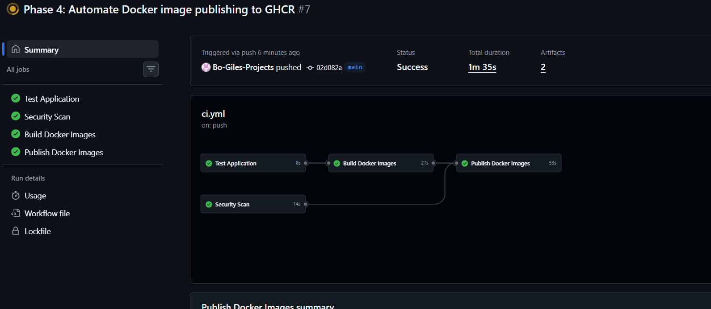
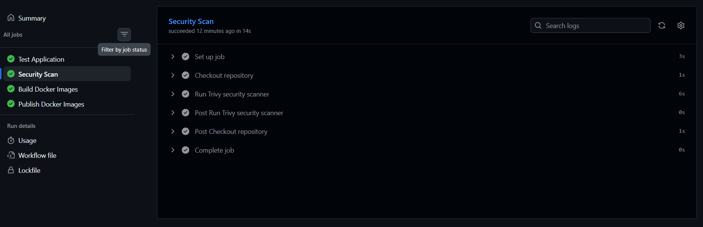
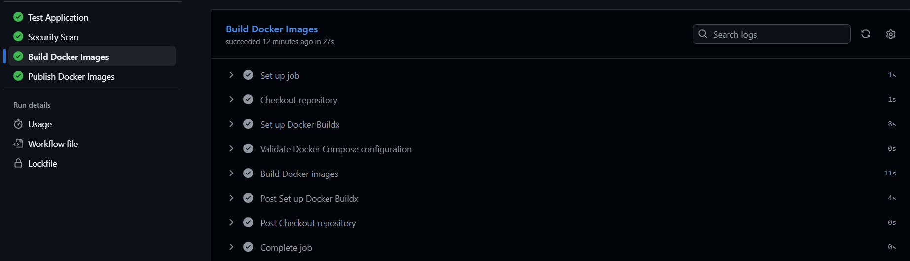
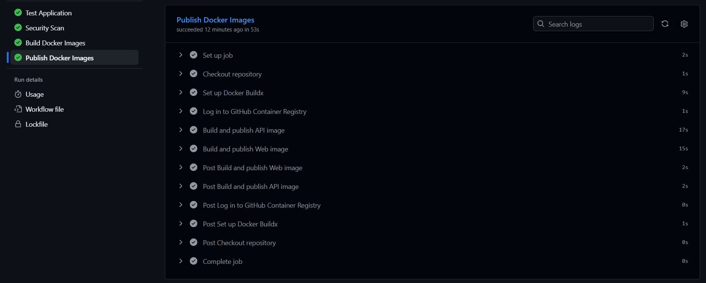

# Phase 4: Continuous Integration and Container Publishing

**Project:** CloudOps Incident Tracker  
**Project Type:** Cloud Engineering / DevOps Portfolio Project  
**Phase:** 4 — CI/CD Automation  
**Status:** Implementation Completed; Final Verification Pending

---

## 1. Project Overview

The goal of this phase was to automate the testing, building, security scanning, and container publishing processes for the CloudOps Incident Tracker application.

In previous phases, I developed a full-stack incident tracking application using React, Node.js, Express, and PostgreSQL. I also containerized the application using Docker and configured Docker Compose to manage the services.

With the application running successfully in containers, the next step was to create an automated workflow that could verify code changes and prepare Docker images for deployment.

I implemented the pipeline using GitHub Actions and integrated automated testing, Docker image builds, vulnerability scanning, and publishing to GitHub Container Registry (GHCR).

This project provided hands-on experience with Continuous Integration (CI), container image management, security automation, and version control.

## 2. Project Objectives

The primary objectives of this phase were to:

1. Configure GitHub Actions to automatically execute workflows when code changes are pushed.
2. Automate dependency installation and application testing.
3. Verify that the React frontend builds successfully.
4. Build Docker images for the frontend and backend services.
5. Integrate automated vulnerability scanning using Trivy.
6. Configure GitHub Container Registry to store versioned Docker images.
7. Establish a reliable foundation for future automated AWS deployments.

## 3. Technologies Used

| Technology                | Purpose                                               |
| ------------------------- | ----------------------------------------------------- |
| GitHub                    | Source code management                                |
| Git                       | Version control                                       |
| GitHub Actions            | CI/CD workflow automation                             |
| Node.js 22                | Application runtime and testing                       |
| Docker                    | Application containerization                          |
| Docker Compose            | Multi-container configuration and local orchestration |
| Docker Buildx             | Container image building                              |
| Trivy                     | Automated vulnerability scanning                      |
| GitHub Container Registry | Container image storage                               |
| YAML                      | GitHub Actions workflow configuration                 |
| VS Code                   | Development environment                               |

## 4. CI/CD Pipeline Architecture

The pipeline uses GitHub Actions to automatically perform several operations whenever changes are pushed to the repository.

### Pipeline Workflow

```text
Developer
    |
    | Pushes code
    v
GitHub Repository
    |
    v
GitHub Actions
    |
    +----------------------+
    |                      |
    v                      v
Application Tests      Security Scan
    |                      |
    v                      |
React Production Build     |
    |                      |
    v                      |
Docker Image Build         |
    |                      |
    +-----------+----------+
                |
                v
       Publish Docker Images
                |
                v
      GitHub Container Registry
                |
                v
      Ready for AWS Deployment
```

Application testing and repository security scanning run independently. Docker image validation runs after application tests pass.

The image publishing job is configured to run after all three earlier jobs succeed, but only when code is pushed to the `main` branch.

**Screenshot 1: GitHub Actions Pipeline Overview**



## 5. Implementation

### 5.1 GitHub Actions Configuration

I configured the CI/CD pipeline using a YAML workflow file located at:

`.github/workflows/ci.yml`

The workflow is triggered by GitHub push and pull request events.

Using GitHub Actions eliminates the need to manually run every test and build whenever the application code changes.

The pipeline consists of four primary jobs.

### 5.2 Automated Application Testing

The first job, **Test Application**, prepares the Node.js environment and verifies the application.

The job performs the following operations:

- Checks out the repository.
- Configures Node.js 22.
- Installs project dependencies using `npm ci`.
- Executes automated API tests.
- Builds the React frontend.

The `npm ci` command installs dependencies from the project's lockfile, helping maintain consistent dependency versions across builds.

Automated testing helps identify problems before application changes are released.

**Screenshot 2: Successful Application Tests**



### 5.3 Automated Docker Image Builds

The second job, **Build Docker Images**, verifies that the application's Docker containers can be built successfully.

The workflow uses Docker Buildx and Docker Compose to build the frontend and backend images.

The job performs two primary operations:

1. Validates the Docker Compose configuration.
2. Builds the application Docker images.

This ensures that code changes remain compatible with the application's container configuration.

The application uses separate Docker images for its React frontend and Node.js backend.

PostgreSQL uses the official PostgreSQL container image.

**Screenshot 3: Successful Docker Builds**



### 5.4 Automated Security Scanning

I integrated Trivy into the GitHub Actions workflow to perform automated vulnerability scanning.

Trivy analyzes the repository filesystem and reports known vulnerabilities that may affect the application or its dependencies.

The scan is configured to report vulnerabilities with the following severity levels:

- HIGH
- CRITICAL

During the initial implementation, the scanner was configured to report findings without automatically failing the workflow.

This allows identified vulnerabilities to be reviewed and addressed before enforcing stricter security requirements.

Although the security scanning job may complete successfully, this does not automatically mean the application is free from vulnerabilities.

**Screenshot 4: Trivy Security Scan**



### 5.5 Docker Image Publishing

The final job, **Publish Docker Images**, is designed
